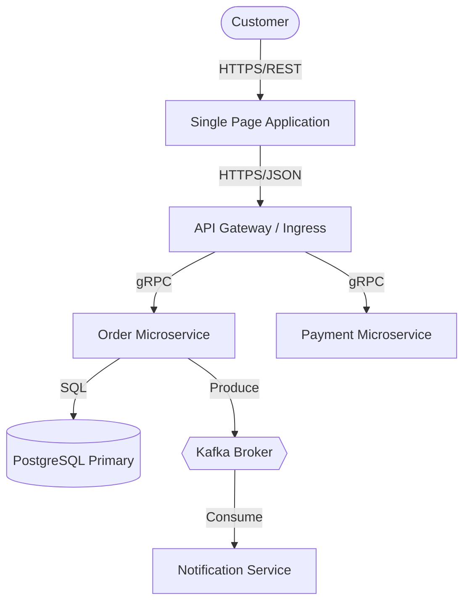

# Software Architecture Patterns & Structural Modeling

> **Authority**: Martin Fowler Architecture Catalog & Simon Brown C4 Model  
> **Applicable Domains**: Architecture Design, Structural Patterns, High/Low-Level Design  
> **Status**: Verified Production Specification  

---

## 1. Primary Architecture Archetypes

| Archetype | Structural Model | Primary Strengths | Severe Anti-Patterns | Ideal Context |
|:---|:---|:---|:---|:---|
| **Monolith** | Single deployable binary; in-memory calls | Fast initial velocity, trivial transactions, simple debugging | Unbounded sprawl, slow builds, tight coupling | Early stage, single team (<10 devs), unproven product |
| **Modular Monolith** | Single binary; strict enforced module boundaries | Monolith deployability with clean domain isolation | Bypassing public APIs via direct SQL joins | Mid-size systems, clear bounded contexts |
| **Microservices** | Independent deployables communicating over network | Independent scaling, team autonomy, isolated deployments | Distributed monolith (shared DB, synchronous call chains) | Large orgs (50+ devs), distinct scaling bottlenecks |
| **Event-Driven (EDA)**| Asynchronous publisher-subscriber via event broker | Extreme decoupling, temporal decoupling, high burst absorption | Eventual consistency lag, event ordering failures | Async workflows, telemetry, high-throughput pipelines |
| **Serverless** | Ephemeral, stateless compute triggered by cloud events | Zero idle cost, automatic horizontal scaling | Cold start latency, connection pool exhaustion | Sporadic traffic, webhook handlers, batch jobs |

---

## 2. Distributed Data Consistency Patterns

### A. Saga Pattern (Distributed Transactions)
Compensating transaction sequences replacing two-phase commit (2PC):
1. **Choreography**: Each service publishes an event triggering the next service.
   - *Pros*: Simple, loose coupling, no coordinator bottleneck.
   - *Cons*: Cyclic dependency risk, hard to trace workflow state.
2. **Orchestration**: A central Saga orchestrator sends commands and handles failures via compensation triggers.
   - *Pros*: Explicit state machine, easy monitoring, simple rollback coordination.
   - *Cons*: Orchestrator can become a single point of failure and bottleneck.

### B. Transactional Outbox Pattern
Guarantees **at-least-once** message publication without dual-write inconsistency:
```sql
-- Step 1: Execute business logic and insert outbox record in ONE local ACID transaction
BEGIN;
INSERT INTO orders (id, user_id, amount, status) VALUES ('ord_123', 'usr_456', 99.00, 'CREATED');
INSERT INTO outbox_events (id, aggregate_type, aggregate_id, event_type, payload, created_at)
VALUES (gen_random_uuid(), 'ORDER', 'ord_123', 'OrderCreated', '{"amount": 99.00}', NOW());
COMMIT;

-- Step 2: Outbox relay (CDC like Debezium or polling worker) publishes to Kafka/RabbitMQ
-- Step 3: Delete or mark outbox event as PROCESSED only after broker ACK
```

### C. CQRS (Command Query Responsibility Segregation)
Separates read and write data paths:
- **Write Model (Command)**: Normalized OLTP store optimized for business invariants and atomic writes.
- **Read Model (Query)**: Denormalized read-optimized stores (Elasticsearch, Redis, Read Replicas) populated asynchronously via CDC or domain events.

---

## 3. Structural & Resilience Patterns

- **Hexagonal / Clean Architecture**: Ports (interfaces) defined in Domain; Adapters (DB, REST, CLI) implemented in Infrastructure. Dependencies point inward only.
- **Circuit Breaker**: Trips from `Closed` to `Open` when downstream error rate exceeds threshold (e.g., $50\%$ over $10\text{s}$), failing fast immediately without hanging sockets. Transitions to `Half-Open` after cooldown to probe health.
- **Bulkhead**: Isolates thread pools and connection pools so failure in non-critical service (e.g., Recommendation) cannot exhaust connections for critical flow (e.g., Checkout).
- **Sidecar / Ambassador**: Offloads logging, mTLS, tracing, and retry logic to an adjacent container proxy (e.g., Envoy).

---

## 4. Architectural Modeling: The C4 Model

Document architectures across 4 standardized zoom levels:

```
[Level 1: System Context] ──> Who uses the system and external dependencies
         │
[Level 2: Container]       ──> Deployable units (Web App, API Service, Database, Queue)
         │
[Level 3: Component]       ──> Modules/classes inside a container (AuthController, PaymentService)
         │
[Level 4: Code]            ──> UML/Interface details (Used sparingly for complex algorithms)
```

### Context Diagram Example (Mermaid)

