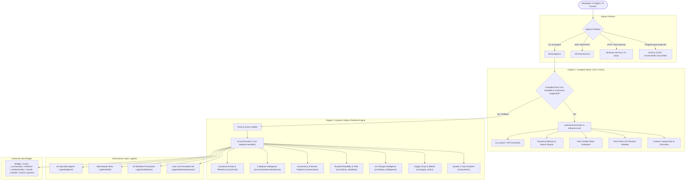
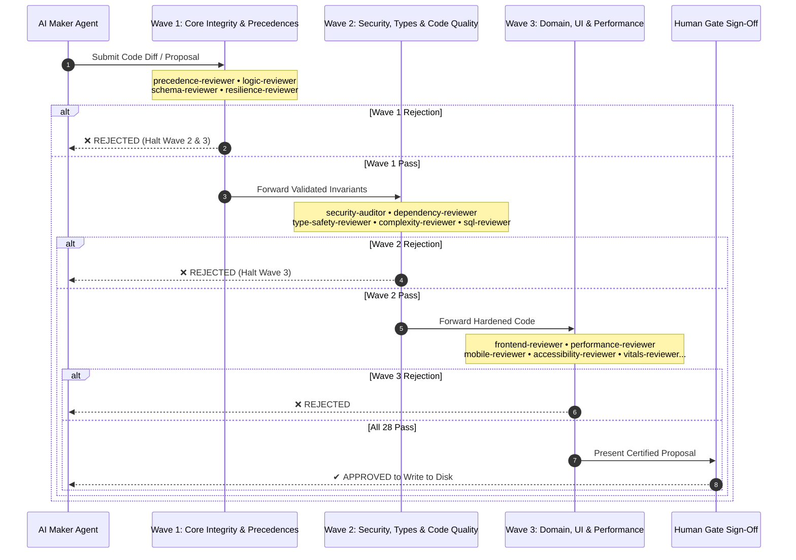

# Tribunal Kit: System Architecture Specification

**Authoritative Architecture Document**  
**Version:** `9.5.0` [VERIFIED: `package.json`]  
**System Classification:** Neurosymbolic AI Coding Agent Governance Layer & Developer Operating System

---

## 1. High-Level Architecture: The Dual-Engine Pipeline

Tribunal Kit employs a **Dual-Engine Architecture** that balances raw execution speed for high-frequency operations with flexible extensibility for multi-agent workflows.

---

## 2. Major Subsystems & Module Breakdown

### 2.1 Native Core Engine (`crates/core`)

- **Language / Runtime:** Rust 2021 edition, multi-threaded via `tokio`.
- **AST Parsing:** High-performance ECMAScript/TypeScript parsing powered by `oxc_parser` and `oxc_allocator`.
- **Primary Responsibilities:**
  1. `commands/ast_extractor.rs`: Rapid static analysis and syntax tree extraction without Node runtime overhead.
  2. `commands/memory.rs`: In-memory and persistent 4-type taxonomy memory indexing with recency scoring and token budget bounding.
  3. `commands/dag_scheduler.rs`: Parallel execution wave dependency resolution and cyclic dependency rejection.
  4. `commands/security.rs`: Null-byte rejection, path traversal prevention, and git revision parameter sanitization.
  5. `commands/context_compress.rs`: Line-pruning context extraction preserving code structures and `// VERIFY` directives.

### 2.2 CLI Ingress & Dynamic Dispatcher (`bin/wrapper.js`, `src/cli.js`)

- **Wrapper Routing:** Inspects incoming commands against `RUST_COMMANDS`. If present in the release binary (`tribunal-core`) and not overridden by `TRIBUNAL_FORCE_JS=1`, executes the Rust binary via `spawnSync`.
- **Lazy Loading Strategy:** `src/cli.js` uses dynamic `require()` loading for all 37 subcommands. Executing `tk status` loads only 4 modules instead of 17+, reducing startup time and file descriptors by ~70%.

### 2.3 Canonical Activity & Telemetry System (`src/activity/`)

- **Typed Schema v1.0.0 (`schema.js`):** Enforces strict UUID/nanoid event ids, ISO-8601 timestamps, lifecycle states, and authoritative verification evidence.
- **Cycle-Safe WeakMap Traversal:** Protects against `RangeError: Maximum call stack size exceeded` in cyclic ASTs or error chains via `WeakMap`-backed memoization in `deepClone` and `WeakSet` visited guards in `redactSecrets`.
- **Multi-Environment Presentation:**
  - `MarkdownRenderer`: Restrained Linear/Cursor typography with responsive wrapping and `
` progressive disclosure.
  - `TerminalRenderer`: ANSI color styling with automatic non-TTY ASCII fallbacks.
  - `StructuredRenderer`: Machine-readable JSON streaming for MCP and CI/CD pipelines.
- **Announcement Intelligence:** Reduces activation noise by 78% via dynamic intent resolution and deduplication (`AnnouncementDeduplicator`).

### 2.4 Codebase Intelligence & Autonomous Architecture Cognition (`src/commands/understand.js`)

- **Seven-Skill Architecture:** Implements a specialized static exploration subsystem:
  1. `repository-reconnaissance`: Workspaces, entry points, and top-level frameworks.
  2. `architecture-mapping`: Module topology, fan-in hubs, and circular cycles.
  3. `execution-flow-tracing`: Traces requests from ingress triggers to test suites.
  4. `code-relevance-analysis`: Task-targeted file retrieval and slice inspection.
  5. `change-impact-analysis`: Concentric blast radius calculation and downstream risk classification.
  6. `evidence-backed-onboarding`: 3-day guided reading orders and verification recipes.
  7. `codebase-intelligence`: Central coordinator and autonomous hypothesis investigation engine.
- **Strict Read-Only Invariant:** 100% in-memory extraction with zero file modifications and SHA-256 state hashing.

### 2.5 Governance & 28-Reviewer Wave Pipeline (`src/execution/`, `.agent/workflows/tribunal-full.md`)

To eliminate context saturation, Tribunal Kit partitions 28 specialized code reviewers into 3 distinct waves:

### 2.6 Agent Runtime Reliability & Recovery (`src/runtime_reliability/`)

- **10-State Formal Finite State Machine:** Manages states across `PENDING`, `RUNNING`, `SUCCEEDED`, `FAILED`, `TIMED_OUT`, `CANCELLED`, `INTERRUPTED`, `PARTIAL`, `RETRYING`, and `BLOCKED` with immutable terminal states.
- **Hierarchical Cancellation Trees:** Binds workflows to Web API `AbortSignal` trees, guaranteeing child process termination and resource cleanup upon timeout or cancellation.
- **Non-Masking Quorum Safety Invariant ($\Delta\text{Critical} = 0$):** Guarantees required agent failures or missing reviews never evaluate to `SUCCEEDED`. Optional reviewer failures produce clean `PARTIAL` verdicts when quorum thresholds (default: 80%) are met.
- **Tamper-Evident SHA-256 Checkpoints:** Snapshots execution state with cryptographic hashes to prevent state tampering between multi-turn iterations.

### 2.7 UI Engineering & Design Intelligence (`src/design_intelligence/`)

- **Closed-Loop 9-Step Design Quality Loop:** Understand $\rightarrow$ Specify $\rightarrow$ Plan $\rightarrow$ Implement $\rightarrow$ Render $\rightarrow$ Inspect $\rightarrow$ Correct $\rightarrow$ Retest $\rightarrow$ Certify.
- **OKLCH Color Harmony & Spatial Math:** Strictly disallows violet/purple AI clichés and mesh gradients, enforcing APCA/WCAG AA contrast ratios, fluid typography clamps, and concentric border radii math.

### 2.8 Supply Chain & Vulnerability Intelligence (`src/supply_chain/`)

- **Engines:** SBOM generator (CycloneDX/SPDX), malicious package detector (typosquatting, install script traps), license compliance engine, and package integrity validator.

---

## 3. Data Flow & Execution Architecture

### 3.1 CLI Command Dispatch Flow

1. User invokes `tk <command> [args]`.
2. `bin/wrapper.js` resolves binary path via `getBinaryPath()`.
3. If `<command>` is in `RUST_COMMANDS` and binary exists, executes `tribunal-core <command>` and returns.
4. Otherwise, loads `src/cli.js` $\rightarrow$ calls `loadCmd('./commands/<command>', 'cmd<Command>')`.
5. Command executes inside security sandbox with path containment checks.
6. Emits structured results via `src/activity/` renderers (Terminal, Markdown, or JSON).

### 3.2 MCP Tool Call Execution Flow

1. Host client (Claude Desktop, Cursor, Zed) sends JSON-RPC `tools/call`.
2. `bin/mcp-server.js` verifies arguments using Zod schemas.
3. Routes to internal engine (e.g. `tribunal_understand` $\rightarrow$ `runCodebaseIntelligenceCli`).
4. Result is serialized via `McpResponseOptimizer` in `src/mcp/response_optimizer.js` (transparent pagination, token estimation, cyclic graph protection).
5. Returns formatted JSON-RPC response with zero double-encoding.

---

## 4. Design Invariants & Security Trust Boundaries

| Boundary                  | Enforcement Point               | Mechanism                                      | Violation Behavior                                |
| :------------------------ | :------------------------------ | :--------------------------------------------- | :------------------------------------------------ |
| **Filesystem Root**       | `src/utils/path_containment.js` | `assertWithinRoot(root, target)`               | Throws `OUT_OF_BOUNDS_ERROR`                      |
| **Network Egress / SSRF** | `src/security/boundary.js`      | `isProhibitedIp()`, DNS resolution check       | Aborts connection; blocks RFC 1918 & metadata IPs |
| **Secret Sanitization**   | `src/activity/schema.js`        | 13 regex token scrubbers                       | Replaces credentials with `[REDACTED_SECRET]`     |
| **State Machine Safety**  | `src/runtime_reliability/`      | State transition lookup table                  | Throws `IllegalStateTransitionError`              |
| **Human Write Gate**      | `bin/mcp-server.js`             | `tribunal_request_write` $\rightarrow$ approve | Blocks disk mutations without human confirmation  |
