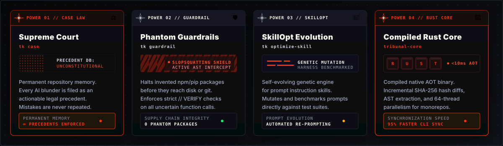
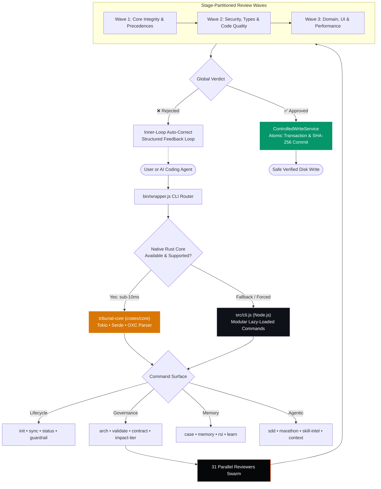
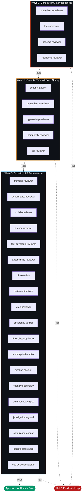

<!-- PROJECT HEADER -->
<div align="center">
  <br>
  <a href="https://github.com/Harmitx7/tribunal-kit">
    
  </a>

  <p align="center">
    <code>ESTD. 2026 // ARTICLE IV § 12 // ZERO-DEPENDENCY GOVERNANCE ENGINE</code>
  </p>

  <h1 style="font-size: 1.85em; color: #ffffff; font-weight: 800; margin: 12px 0 8px 0; letter-spacing: -0.6px;">
    Tribunal Kit
  </h1>
  <p style="font-size: 1.08em; color: #a4adc4; font-weight: 400; letter-spacing: 0.2px; margin: 0 auto 22px auto; max-width: 820px; line-height: 1.55;">
    The zero-dependency governance layer and neurosymbolic verification envelope for AI coding agents. Intercepts AI hallucinations, phantom packages, and architectural regressions locally before code reaches disk.
  </p>

  <!-- BADGES ROW -->
  <div style="margin-bottom: 22px;">
    <a href="https://agentarmorhq.com/skills/harmitx7-tribunal-kit">
      
    </a>
    <a href="https://github.com/Harmitx7/tribunal-kit/releases">
      
    </a>
    <a href="https://www.npmjs.com/package/tribunal-kit">
      
    </a>
    <a href="https://github.com/Harmitx7/tribunal-kit/actions/workflows/ci.yml">
      
    </a>
    <a href=".agent/skills">
      
    </a>
    <a href=".agent/workflows/tribunal-full.md">
      
    </a>
    <a href="crates/core">
      
    </a>
    <a href="LICENSE">
      
    </a>
  </div>

  <!-- COMPATIBILITY CHIP ROW -->
  <div style="margin-bottom: 26px;">
    <span style="color: #8a92a3; font-size: 0.9em; text-transform: uppercase; letter-spacing: 0.8px;">Universal Agent Bridges:</span><br>
    <code>Cursor</code> • <code>Claude Code</code> • <code>Windsurf</code> • <code>GitHub Copilot</code> • <code>Aider</code> • <code>Devin</code> • <code>Gemini CLI</code> • <code>Codex</code> • <code>Cline</code>
  </div>

  <!-- QUICK INSTALL HERO TERMINAL -->
  <table style="border-collapse: collapse; margin: 0 auto; background: #060709; border: 1px solid #222634; border-radius: 8px;">
    <tr>
      <td style="padding: 10px 18px; font-family: ui-monospace, monospace; font-size: 0.92em; color: #f5f2eb;">
        <span style="color: #ff3300; font-weight: bold;">$</span> npx tribunal-kit init <span style="color: #8a92a3;">&amp;&amp;</span> npx tribunal-kit status
      </td>
    </tr>
  </table>
  <br>

  <!-- QUICK NAVIGATION PILL MATRIX -->
  <p align="center" style="font-size: 0.9em;">
    <a href="#overview"><b>[ ⚡ Overview ]</b></a> &nbsp;•&nbsp;
    <a href="#quick-start"><b>[ 🚀 Quick Start ]</b></a> &nbsp;•&nbsp;
    <a href="#cli-cockpit"><b>[ 💻 CLI Reference ]</b></a> &nbsp;•&nbsp;
    <a href="#reviewers"><b>[ 🛡 31 Reviewers ]</b></a> &nbsp;•&nbsp;
    <a href="#architecture"><b>[ 🏗 Architecture ]</b></a> &nbsp;•&nbsp;
    <a href="#security"><b>[ 🔒 Security ]</b></a> &nbsp;•&nbsp;
    <a href="#mcp"><b>[ 🔌 MCP Server ]</b></a>
  </p>
</div>

---

<a id="table-of-contents"></a>
## 📑 Structured Directory & Index

<table width="100%">
  <tr>
    <td width="33%" valign="top">
      <b>01 // Architecture & Core</b>
      <ul>
        <li><a href="#overview">What is Tribunal Kit?</a></li>
        <li><a href="#problem-solution">Problem vs. Solution Matrix</a></li>
        <li><a href="#core-capabilities">Core Superpower Breakdown</a></li>
        <li><a href="#architecture">Dual-Engine Pipeline Execution</a></li>
      </ul>
      <b>02 // Getting Started</b>
      <ul>
        <li><a href="#quick-start">Prerequisites & Quick Start</a></li>
        <li><a href="#hardened-installation">Hardened Installation</a></li>
        <li><a href="#step-by-step">Step-by-Step Initialization</a></li>
        <li><a href="#cli-adapters">CLI Agent Adapters (tk-adapt)</a></li>
        <li><a href="#minimal-mode">Minimal Mode (~21 Specialists)</a></li>
      </ul>
    </td>
    <td width="33%" valign="top">
      <b>03 // Governance & Operations</b>
      <ul>
        <li><a href="#cli-cockpit">Command Cockpit & CLI Surface</a></li>
        <li><a href="#global-flags">Global Execution Flags</a></li>
        <li><a href="#reviewers">The 31 Reviewers (3 Waves)</a></li>
        <li><a href="#reviewer-matrix">Domain Activation Matrix</a></li>
      </ul>
      <b>04 // Integrations & Protocol</b>
      <ul>
        <li><a href="#ide-bridges">IDE Bridge Architecture</a></li>
        <li><a href="#mcp">Model Context Protocol (MCP)</a></li>
        <li><a href="#env-vars">Environment Variables & Overrides</a></li>
        <li><a href="#agent-compatibility">Universal Agent Matrix</a></li>
      </ul>
    </td>
    <td width="34%" valign="top">
      <b>05 // Ecosystem & Skills</b>
      <ul>
        <li><a href="#skills-standard">18-Section Governance Standard</a></li>
        <li><a href="#domain-references">23 Technical Domain References</a></li>
      </ul>
      <b>06 // Security & Invariants</b>
      <ul>
        <li><a href="#security">Centralized Containment (boundary.js)</a></li>
        <li><a href="#ssrf-defense">SSRF & Metadata Defense</a></li>
        <li><a href="#zero-deps">Supply-Chain & Minimal Dependencies</a></li>
        <li><a href="#permissions">Permissions & Blast-Radius Transparency</a></li>
        <li><a href="#threat-model">Containment Trust Boundaries</a></li>
      </ul>
      <b>07 // Development & Meta</b>
      <ul>
        <li><a href="#testing">Local Compilation & Tests</a></li>
        <li><a href="#repository-tree">Repository Architecture</a></li>
        <li><a href="#troubleshooting">Diagnostic & Troubleshooting</a></li>
        <li><a href="#contributing">Contributing & Disclosures</a></li>
      </ul>
    </td>
  </tr>
</table>

---

<a id="overview"></a>
## 01 // Architecture & Core Invariants

<a id="problem-solution"></a>
### What is Tribunal Kit?

AI coding assistants hallucinate. They invent packages that do not exist on public package registries (**"slopsquatting"**), invoke deprecated framework APIs, emit unparameterized SQL queries, invent non-existent database columns, and repeat identical blunders across development sessions.

Compilers and linters catch these errors only **after** the code is already written to disk—completely blind to multi-file semantic intent or agent task planning during generation.

**Tribunal Kit acts as a neurosymbolic verification envelope.** It intercepts AI agent outputs locally before disk writes, validates proposals against your repository's live AST and schema models, and evaluates them with a deterministic 31-reviewer swarm running across 3 partitioned waves.

<div align="center">
  <br>
  
  <br><br>
</div>

#### Problem vs. Solution Matrix

| Threat Vector | Unprotected AI Agent Behavior | Tribunal Kit Verification Envelope |
| :--- | :--- | :--- |
| **Supply Chain / Slopsquatting** | Agent imports fictional npm/pip packages vulnerable to malicious namespace hijacking. | **`tk guardrail`** parses AST imports and checks package manifests before changes reach disk. |
| **Cognitive Amnesia Loops** | Agent repeats the exact same rejected architectural blunder across subsequent sessions. | **`tk case` & `tk memory`** record rejections as binding legal precedents injected into future context. |
| **Context Saturation & Hallucination** | Massive context dumps saturate the LLM window, causing hallucination spikes. | **`tk context`** extracts strict AST call-graphs and compresses payloads to bounded token budgets. |
| **Late Failure Detection** | CI workflows and linters catch broken contracts hours later after code is merged. | **Stage-Partitioned Waves** run 31 reviewers in sub-second parallel passes prior to human gate. |
| **Transitive Regressions** | Refactoring one service breaks distant consumers across the monorepo silently. | **`tk arch impact`** maps blast radiuses and transitive callers through graph extraction. |

---

<a id="core-capabilities"></a>
### Core Superpower Breakdown

<div align="center">
  
</div>

<table width="100%">
  <thead>
    <tr>
      <th width="24%">Superpower</th>
      <th width="14%">Keycap Tag</th>
      <th width="38%">Operational Purpose</th>
      <th width="24%">Primary Command</th>
    </tr>
  </thead>
  <tbody>
    <tr>
      <td><b>Compiled Rust Core</b></td>
      <td><code>[RUST]</code> <code>[OXC]</code></td>
      <td>Sub-10ms AST parsing, semantic graph extraction, SHA-256 diffing, and Kahn's DAG scheduler.</td>
      <td><code>crates/core</code></td>
    </tr>
    <tr>
      <td><b>Minimal Supply-Chain Footprint</b></td>
      <td><code>[MIN-DEPS]</code></td>
      <td>Production npm package has exactly <b>1 vetted dependency</b> (<code>zod</code> for schema validation). Completely isolates supply chain risk.</td>
      <td><code>package.json</code></td>
    </tr>
    <tr>
      <td><b>Supreme Court Case Law</b></td>
      <td><code>[CASE]</code> <code>[LAW]</code></td>
      <td>Records rejected patterns as binding precedents. Agents query Case Law before code generation.</td>
      <td><code>tk case search &lt;q&gt;</code></td>
    </tr>
    <tr>
      <td><b>4-Type Cognitive Memory</b></td>
      <td><code>[MEM]</code> <code>[TAXON]</code></td>
      <td>Persists <code>semantic</code>, <code>procedural</code>, <code>episodic</code> (30d TTL), and <code>working</code> state with token budgeting.</td>
      <td><code>tk memory recall</code></td>
    </tr>
    <tr>
      <td><b>Subagent-Driven Dev</b></td>
      <td><code>[SDD]</code> <code>[BRIEF]</code></td>
      <td>Slices implementation plans out-of-band and isolates context windows to prevent token bloat.</td>
      <td><code>tk sdd brief</code></td>
    </tr>
    <tr>
      <td><b>Architecture Intelligence</b></td>
      <td><code>[ARCH]</code> <code>[BLAST]</code></td>
      <td>Zero-trust architecture mapping, circular dependency detection, and transitive impact calculation.</td>
      <td><code>tk arch impact &lt;target&gt;</code></td>
    </tr>
    <tr>
      <td><b>Web & Browser Intel</b></td>
      <td><code>[CDP]</code> <code>[IDPI]</code></td>
      <td>Direct CDP browser client with Indirect Prompt Injection defense and DOM reverse-engineering.</td>
      <td><code>tk browse &lt;url&gt;</code></td>
    </tr>
    <tr>
      <td><b>Native MCP Server</b></td>
      <td><code>[MCP]</code> <code>[RPC]</code></td>
      <td>Exposes controlled writes, 2-phase transactions, and memory recall over JSON-RPC 2.0 stdio.</td>
      <td><code>bin/mcp-server.js</code></td>
    </tr>
  </tbody>
</table>

---

<a id="architecture"></a>
### Dual-Engine Pipeline Execution

Tribunal Kit employs a **dual-engine execution architecture**. Commands are first routed through the compiled native Rust binary (`tribunal-core`). If the binary is unavailable, uncompiled, or if the environment forces JavaScript (`TRIBUNAL_FORCE_JS=1`), execution seamlessly falls back to the modular JavaScript engine (`src/cli.js`).



<div align="center">
  <br>
  
  <br>
</div>

---

<a id="quick-start"></a>
## 02 // Quick Start & Installation

<a id="prerequisites"></a>
### Prerequisites

- **Node.js:** `>= 18.0.0` (LTS recommended)
- **Rust Toolchain:** *(Optional)* Precompiled binaries for Linux (x64, arm64), macOS (Apple Silicon, Intel), and Windows (x64, arm64) are distributed via optional dependencies. Cargo is only required if compiling from source.

<a id="hardened-installation"></a>
### Hardened Installation (Zero-Lifecycle Scripts)

Tribunal Kit enforces a **zero install-time lifecycle script** policy (`no preinstall, install, or postinstall` scripts in `package.json`). For high-security environments, you can safely invoke or install Tribunal Kit with npm script execution explicitly disabled:

```bash
# Execute directly via npx with script execution disabled
npx -y --ignore-scripts tribunal-kit@9.3.0 init

# Or install globally with script isolation
npm install -g --ignore-scripts tribunal-kit@9.3.0
```

<a id="step-by-step"></a>
### Step-by-Step Initialization

#### Step 01: Scaffold the Governance Payload

Run `init` from the root of your target application repository:

```bash
# Initialize .agent/ governance payload and IDE rule bridges
npx tribunal-kit init
```

> [!NOTE]
> **Self-Install Safeguard:** Tribunal Kit prevents running `init` inside the `tribunal-kit` repository itself. Run `init` from external target project directories.

#### Step 02: Verify Repository Health Cockpit

Inspect active bridges, memory counters, and reviewer readiness:

```bash
npx tribunal-kit status
```

#### Step 03: Synchronize Editor Rule Bridges

Generate and update IDE bridge configuration files:

```bash
npx tribunal-kit sync
```

<a id="cli-adapters"></a>
### CLI Agent Adapters (`tk-adapt` / `tk adapt`)

For developers using terminal-based AI coding agents, install native bridges with a single command:

```bash
# Auto-detect all installed CLI agents and configure them
npx tk-adapt
# Or via main CLI
npx tribunal-kit adapt

# Or configure for a specific CLI agent
npx tk-adapt claude     # Claude Code CLI (.claude/CLAUDE.md + MCP)
npx tk-adapt aider      # Aider CLI (.aider.conf.yml + CONVENTIONS.md)
npx tk-adapt codex      # OpenAI Codex CLI (AGENTS.md)
npx tk-adapt gemini-cli # Google Gemini CLI (.gemini/rules/GEMINI.md)
```

<a id="minimal-mode"></a>
### Minimal Installation Mode (`--minimal`)

For resource-constrained setups or microservices, install the streamlined core payload (~21 core specialists, ~19 core skills):

```bash
npx tribunal-kit init --minimal
```

---

<a id="cli-cockpit"></a>
## 03 // Command Cockpit & CLI Surface

Both binary identifiers are registered: `tribunal-kit` and `tk`.

```bash
tk <command> [subcommand] [flags]
```

<a id="complete-command-reference"></a>
### Complete Command Reference

| Category | Command | Syntax & Subcommands | Operational Description |
| :--- | :--- | :--- | :--- |
| **Core Lifecycle** | `init` | `tk init [--force] [--minimal] [--dry-run]` | Initializes `.agent/` and scaffolds IDE bridges in target directory. |
| | `status` | `tk status [--json] [--quiet]` | Displays high-density architecture cockpit and reviewer readiness. |
| | `sync` | `tk sync` | Synchronizes IDE rule bridges (`.cursorrules`, `CLAUDE.md`, `AGENTS.md`). |
| | `guardrail`| `tk guardrail [--file <path>] [--fix] [--json]` | Audits changes for phantom packages, broken links, and `// VERIFY` tags. |
| | `update` | `tk update` | Upgrades installed `.agent/` directory to match the latest engine version. |
| | `uninstall`| `tk uninstall [--dry-run]` | Removes `.agent/` folder with automated pre-removal backup archive. |
| | `hook` | `tk hook` | Installs automated Git pre-push governance hook into `.git/hooks/`. |
| **Architecture** | `validate` | `tk validate [--file <path>] [--schema <type>]` | Validates `.agent/` directory or checks JSON payloads against Serde schemas. |
| | `arch` | `tk arch <map\|verify\|impact\|diff\|audit>` | Zero-Trust Architecture Intelligence and blast radius simulation. |
| | `contract` | `tk contract <init\|verify\|list\|trace\|replay>` | AI behavioral contract testing, trace replay, and case-to-contract generation. |
| | `graph` | `tk graph` | Builds and visualizes dependency architecture and module call graphs. |
| | `impact-tier`| `tk impact-tier [--files <list>] [--lines <n>]` | Classifies change impact tier (0: Fast-Pass, 1: Express, 2: Audit, 3: Full). |
| **Memory & Precedents** | `case` | `tk case <add\|search\|list\|show\|overrule>` | Supreme Court Case Law engine for recording mistake precedents. |
| | `memory` | `tk memory <store\|recall\|gc\|stats\|export>` | 4-Type Taxonomy Persistent Memory engine (`semantic`, `procedural`, etc.). |
| | `rsi` | `tk rsi <status\|run\|watch\|rollback\|freeze>` | Recursive Self-Improvement Engine with Write-Ahead Logging (WAL). |
| | `evolve` | `tk evolve [--rounds <n>] [--strategy <type>]` | Asymmetric dual-loop prompt instruction auto-tuning against test suites. |
| | `learn` | `tk learn` | Extracts recurring project idioms and coding conventions from git diffs. |
| | `mutate` | `tk mutate [--target <file>]` | Mutation testing engine that injects faults to test test-suite reliability. |
| **Agentic Workflows**| `marathon` | `tk marathon <init\|status\|next\|mark\|log>` | Long-running autonomous agent harness with session checkpointing. |
| | `sdd` | `tk sdd <workspace\|brief\|diff>` | Subagent-Driven Development workspace isolation and task brief extraction. |
| | `skill-intel`| `tk skill-intel <query> [--gate] [--contract]` | Autonomous skill discovery and 11-point skill creation gate. |
| | `compile` | `tk compile [--skills <list>]` | Compresses skills and rules into a static Super-Prompt for CLI agents. |
| | `context` | `tk context [--file <path>]` | Retrieves token-optimized context dossier with structural AST call-sites. |
| | `align` | `tk align [--file <path>]` | Cleans AI outputs: strips decorative slop, removes excessive bulleting. |
| **Web & Browser** | `browse` | `tk browse <url> [--json]` | Token-efficient web reader (<1.5k tokens) with IDPI prompt defense. |
| | `audit-web`| `tk audit-web <url> [--json]` | Live browser accessibility, console errors, and Core Web Vitals auditor. |
| | `compare-web`| `tk compare-web <url1> <url2>` | Visual regression differ for CI and release gating via CDP. |
| | `deconstruct`| `tk deconstruct <url> --selector <sel>` | Reverse-engineers live DOM elements into modular React TSX components. |
| | `heal` | `tk heal [--url <url>]` | Runtime Sentinel that catches uncaught browser errors and verifies live fixes. |
| **Neural Expansion**| `system1` | `tk system1 <setup\|enable\|disable\|status>` | Optional local ONNX neural assessment engine for sub-ms impact tiering. |

<a id="global-flags"></a>
### Global Execution Flags

```text
--path <dir>         Target a specific project directory (defaults to cwd)
--file <path>        Specify input file for validation, context, or guardrail scanning
--force              Force overwrite existing configuration files during initialization
--minimal            Install core agents & skills only (~21 specialists)
--dry-run            Preview actions without writing disk changes
--json               Emit machine-readable JSON output for CI pipelines
--quiet              Suppress all non-essential banners and output
--verbose            Show detailed debug logging and internal execution traces
--version, -v        Print installed package and native core version (9.3.0)
```

---

<a id="reviewers"></a>
## 04 // The 31-Reviewer Verification Swarm

When code is checked via `tk validate`, `/tribunal-full`, or git pre-push hooks, Tribunal Kit invokes **31 specialized domain reviewers**. To eliminate context window dilution, reviewers execute in three stage-partitioned waves.

<a id="3-wave-execution-stage-partitioning"></a>
### 3-Wave Execution Stage Partitioning



<a id="reviewer-matrix"></a>
### Domain Activation Matrix

Reviewers automatically adapt to the code under review. Unrelated reviewers auto-pass with `N/A`, maximizing pipeline throughput:

| Target File / Context | Active Critical Reviewers |
| :--- | :--- |
| **REST / GraphQL API** | `logic`, `security`, `dependency`, `type-safety`, `sql`, `schema`, `resilience`, `auth-boundary` |
| **React / Next.js Component**| `logic`, `frontend`, `accessibility`, `ui-ux`, `type-safety`, `review-animations`, `vitals` |
| **Database Migration & Query**| `logic`, `security`, `sql`, `schema`, `db-latency`, `resilience` |
| **AI / LLM Integration** | `logic`, `security`, `ai-code`, `dependency`, `cognitive-boundary` |
| **Mobile (React Native / Expo)**| `mobile`, `logic`, `security`, `performance`, `accessibility`, `ui-ux` |
| **CI/CD Workflow & Dockerfile**| `pipeline-checker`, `security`, `secrets-leak-guard`, `dependency` |

---

<a id="ide-bridges"></a>
## 05 // Ecosystem, IDE Bridges & MCP Server

<a id="ide-bridge-architecture"></a>
### IDE Bridge Architecture

When `tk init` or `tk sync` runs, Tribunal Kit generates bridge files that hook directly into the system prompts of major AI coding environments:

```text
Your Project Root
├── .cursorrules                         ← Cursor IDE bridge
├── .windsurfrules                       ← Windsurf IDE bridge
├── .claude/CLAUDE.md                    ← Claude Code directory bridge
├── CLAUDE.md                            ← Claude Code root bridge
├── AGENTS.md                            ← OpenAI Codex & multi-agent system bridge
├── .github/copilot-instructions.md      ← GitHub Copilot workspace instructions
└── .gemini/
    ├── settings.json                    ← Antigravity / Gemini tool & skill configuration
    └── GEMINI.md                        ← Master Gemini rules bridge
```

---

<a id="mcp"></a>
### Model Context Protocol (MCP) Server

Tribunal Kit provides a production-grade MCP server (`bin/mcp-server.js`) communicating over JSON-RPC 2.0 stdio:

#### Client Configuration (`mcp_config.json`)

```json
{
  "mcpServers": {
    "tribunal-kit": {
      "command": "node",
      "args": ["bin/mcp-server.js"],
      "env": {
        "NODE_ENV": "production"
      }
    }
  }
}
```

#### Key MCP Tools

- `tribunal_request_write`: Requests a controlled repository mutation, returning a preview diff and cryptographic authorization token.
- `tribunal_commit_write`: Atomically commits an approved write transaction to disk with SHA-256 rollback protection.
- `search_case_law`: Queries historical code rejections and legal precedents.
- `recall_memory`: Recalls budget-constrained memories ranked by relevance, recency, and priority.
- `store_memory`: Persists a validated memory entry across sessions (`semantic`, `procedural`, `episodic`, `working`).
- `run_tribunal_audit`: Executes workspace-wide anti-hallucination audits.

---

<a id="env-vars"></a>
### Environment Variables & Overrides

| Environment Variable | Supported Values | Operational Impact |
| :--- | :--- | :--- |
| `TRIBUNAL_FORCE_JS` | `1`, `true` | Bypasses the compiled Rust binary and forces the pure JavaScript runtime. |
| `TRIBUNAL_CORE_PATH` | `/absolute/path` | Overrides auto-detection with an explicit path to a compiled `tribunal-core` binary. |
| `TK_SKIP_UPDATE_CHECK` | `1`, `true` | Disables automated npm registry update checks during `init` and `update`. |
| `TK_AUTO_BUILD` | `1`, `true` | Automatically attempts to build the Rust core locally with `cargo build --release` if missing. |

---

<a id="skills-standard"></a>
## 06 // Skills Corpus & Technical References

Tribunal Kit includes a curated, schema-validated corpus of **235 modular engineering skills** located in `.agent/skills/`.

<a id="18-section-governance-standard"></a>
### 18-Section Governance Standard

All 235 skills adhere to a strict 18-section governance architecture designed to eliminate LLM ambiguity:

1. **Frontmatter:** Strict YAML metadata (`name`, `description`, `version`, `domain`, `triggers`).
2. **Mental Sandbox:** Epistemic confidence levels (L1–L5) and anti-hallucination guardrails.
3. **Pre-Flight Checklist:** Mandatory files and packages to inspect before generating code.
4. **VBC Protocol:** Non-negotiable Verification-Before-Completion test execution commands.
5. **Tri-State Evidence Classification:** All findings and claims must be explicitly tagged:
   - `[OBSERVED]`: Confirmed directly by terminal command output, AST query, or file inspection.
   - `[INFERRED]`: Reasoned logically from active code structures with stated assumptions.
   - `[UNVERIFIED]`: Speculative hypothesis requiring explicit verification before commitment.

---

<a id="domain-references"></a>
### Hybrid Domain Reference Specifications (Model C)

To prevent LLM context saturation, deep technical domain standards are partitioned into **23 compact, zero-hallucination reference specifications** (<1,500 tokens each) under `.agent/references/`:

<table width="100%">
  <thead>
    <tr>
      <th width="20%">Technical Domain</th>
      <th width="35%">Authoritative Specifications</th>
      <th width="15%">Token Budget</th>
      <th width="30%">Canonical Location</th>
    </tr>
  </thead>
  <tbody>
    <tr>
      <td><b>System Design & Scale</b></td>
      <td>16 Specs: Little's Law, C4 Modeling, Raft/Paxos, Sharding, Kafka, STRIDE, SLOs, Global Multi-Region, 8 Blueprints.</td>
      <td>&lt; 2,000 tok / spec</td>
      <td><code>.agent/references/domains/system-design/</code></td>
    </tr>
    <tr>
      <td><b>Security Architecture</b></td>
      <td>OWASP Top 10 API Security Risks, WebAuthn & Passkey Authentication.</td>
      <td>&lt; 1,500 tok / spec</td>
      <td><code>.agent/references/domains/security/</code></td>
    </tr>
    <tr>
      <td><b>Database & Storage</b></td>
      <td>PostgreSQL pgvector & HNSW Tuning, Zero-Downtime Migrations, Index Tuning.</td>
      <td>&lt; 1,500 tok / spec</td>
      <td><code>.agent/references/domains/database/</code></td>
    </tr>
    <tr>
      <td><b>Frontend Engineering</b></td>
      <td>React 19 RSC & Server Actions, WAI-ARIA APG Patterns, Tailwind CSS v4.</td>
      <td>&lt; 1,500 tok / spec</td>
      <td><code>.agent/references/domains/frontend/</code></td>
    </tr>
    <tr>
      <td><b>Cloud & DevOps</b></td>
      <td>Hardened GitHub Actions & OIDC, Docker Rootless, OpenTofu State.</td>
      <td>&lt; 1,500 tok / spec</td>
      <td><code>.agent/references/domains/devops/</code></td>
    </tr>
    <tr>
      <td><b>Backend Systems</b></td>
      <td>FastAPI Concurrency, Node.js Event Loop Streams, Redis Distributed Locks.</td>
      <td>&lt; 1,500 tok / spec</td>
      <td><code>.agent/references/domains/backend/</code></td>
    </tr>
    <tr>
      <td><b>Mobile Systems</b></td>
      <td>Expo Router v4 Deep Linking, Mobile Ergonomics & Apple HIG Guidelines.</td>
      <td>&lt; 1,500 tok / spec</td>
      <td><code>.agent/references/domains/mobile/</code></td>
    </tr>
    <tr>
      <td><b>Motion & Animations</b></td>
      <td>GSAP v3 Timeline Architecture, 60fps Web Animation & GPU Layers.</td>
      <td>&lt; 1,500 tok / spec</td>
      <td><code>.agent/references/domains/motion/</code></td>
    </tr>
    <tr>
      <td><b>AI & Shared Standards</b></td>
      <td>RAG Hybrid Search & Re-ranking, Model Context Protocol (MCP) Spec, RFC 9110 HTTP.</td>
      <td>&lt; 1,500 tok / spec</td>
      <td><code>.agent/references/domains/ai/</code></td>
    </tr>
  </tbody>
</table>

---

<a id="security"></a>
## 07 // Security Architecture & Trust Boundaries

<a id="centralized-containment-boundaryjs"></a>
### 1. Centralized Containment (`src/security/boundary.js`)

All file interactions are mediated through `assertWithinRoot`. This function enforces:
- **Lexical Containment:** Rejects any path resolving outside the project root via `path.relative`.
- **Symlink Escape Protection:** Resolves realpaths via `fs.realpathSync.native` to ensure symlinks cannot point to sensitive host directories (`/etc`, `C:\Windows`).
- **Null-Byte Injection Neutralization:** Rejects any string containing `\0`.

<a id="ssrf-defense"></a>
### 2. SSRF & Cloud Metadata Defense

The browser and web intelligence engine enforces strict outbound network policies via `validateBrowserUrl`:
- **Cloud Metadata Protection:** Unconditionally blocks access to link-local and cloud metadata IPs (`169.254.169.254`, `fd00:ec2::254`).
- **Private Subnet Isolation:** Blocks loopback (`127.0.0.0/8`, `::1`), RFC 1918 private subnets (`10.0.0.0/8`, `172.16.0.0/12`, `192.168.0.0/16`), and Carrier-Grade NAT.
- **Scheme & Port Restrictions:** Permits only `http:` and `https:`. Rejects sensitive administrative ports (`22`, `25`, `2375`, `6379`, `27017`).

<a id="zero-deps"></a>
### 3. Supply-Chain Purity & Minimal Dependencies

- **Minimal Production Dependencies:** Exactly 1 vetted production runtime dependency (`zod: "^4.6.7"` for deterministic schema validation and boundary guarantees). Zero extraneous dependencies or deep dependency trees.
- **Zero Install Lifecycle Scripts:** `package.json` contains no `preinstall`, `install`, or `postinstall` scripts, preventing arbitrary code execution during installation.
- **Verifiable SLSA Provenance:** All releases are built via pinned GitHub Actions workflows and signed with Sigstore provenance (`npm publish --provenance`).
- **Runtime Network Neutrality:** The CLI operates **100% offline** by default. It performs zero telemetry, zero analytics, and zero phone-home calls. The only network request is an optional npm version check during `init`, which is completely skippable via `--skip-update-check` or `TK_SKIP_UPDATE_CHECK=1`.

<a id="permissions"></a>
### 4. Permissions & Blast-Radius Transparency

Tribunal Kit maintains an evidence-backed capability inventory to ensure complete transparency regarding host interactions:

| Domain | Scope | Active Boundary Enforcement |
| :--- | :--- | :--- |
| **Filesystem Read** | Workspace project files, manifests, and AST trees. | Read-only access confined to workspace root. |
| **Filesystem Write** | `.agent/`, `.claude/`, `.gemini/`, `.cursor/` governance trees. | `assertWithinRoot` validates lexical paths and native symlink realpaths. |
| **Subprocess Execution** | Local linters, test runners, git status. | Strictly array-based `child_process.spawnSync` without shell interpolation. |
| **Network Egress** | Offline CLI. Audit browser strictly gated. | `validateBrowserUrl` blocks RFC 1918 subnets, cloud metadata (`169.254.169.254`), and loopback. |

> Complete line-by-line capability mappings are audited and maintained in [docs/security/CAPABILITY_INVENTORY.md](docs/security/CAPABILITY_INVENTORY.md).

<a id="threat-model"></a>
### 5. Containment Trust Boundaries

> [!WARNING]
> **Operational Boundary Clarification:** Tribunal Kit is an **application-level governance layer and neurosymbolic verification envelope**. It is not an operating system container, virtual machine, or Linux seccomp sandbox. While it blocks unauthorized writes and validates code structure, it should be paired with standard container isolation (e.g. Docker, Dev Containers) when executing arbitrary untrusted code.

---

<a id="testing"></a>
## 08 // Local Compilation & Test Suites

<a id="development-setup"></a>
### Development Setup

```bash
# Clone the repository
git clone https://github.com/Harmitx7/tribunal-kit.git
cd tribunal-kit

# Install devDependencies (Jest, TypeScript, ESLint, Prettier)
npm install
```

<a id="test-commands--validation-suites"></a>
### Test Commands & Validation Suites

```bash
# Run unit tests with Jest
npm run test:unit

# Run native Rust core test suite (89 tests)
npm run test:rust

# Validate .agent/ payload integrity and reference links
npm run validate-payload

# Run full test suite across JavaScript and Rust
npm run test:all
```

<a id="rust-core-compilation--benchmarking"></a>
### Rust Core Compilation & Benchmarking

```bash
# Compile tribunal-core in release mode (LTO + stripped)
cargo build --release --manifest-path crates/core/Cargo.toml

# Run performance benchmarks comparing Rust core vs JavaScript fallback
npm run benchmark:rust
```

---

<a id="repository-tree"></a>
## 09 // Repository Architecture

```text
tribunal-kit/
├── bin/                             # Executable entry points
│   ├── wrapper.js                   # Primary CLI wrapper (Rust dispatch + JS fallback)
│   ├── adapter-install.js           # Universal CLI agent adapter installer (tk-adapt)
│   ├── mcp-server.js                # Model Context Protocol stdio server
│   └── tk-proxy.js                  # Interception proxy for coding agents
├── crates/core/                     # High-performance native Rust core
│   ├── Cargo.toml                   # Rust package manifest (Tokio, Clap, Serde, OXC)
│   └── src/
│       ├── main.rs                  # CLI parser, command routing & Serde schemas
│       ├── commands/                # 20 native command implementations
│       └── tui/                     # Native terminal UI formatting
├── src/                             # Modular JavaScript CLI runtime (lazy-loaded)
│   ├── cli.js                       # CLI argument router and command registry
│   ├── commands/                    # 35 individual command implementations
│   ├── security/                    # Centralized containment & SSRF boundary service
│   ├── execution/                   # Controlled write service & transaction engines
│   ├── browser/                     # Chrome DevTools Protocol & IDPI defense
│   ├── system1/                     # Optional local ONNX neural assessment provider
│   └── tui/                         # Progress bars, reviewer grid matrix, banner
├── .agent/                          # Intelligence & Governance Payload
│   ├── agents/                      # 60 specialist agents (31 reviewers)
│   ├── skills/                      # 235 schema-validated engineering skills
│   ├── references/                  # 23 zero-hallucination domain specifications
│   ├── workflows/                   # 51 audited slash-command workflows
│   ├── rules/                       # Master governance rules (GEMINI.md, kernel.md)
│   └── scripts/                     # 106 automated verification & audit scripts
├── docs/                            # Visual assets, architecture diagrams & documentation
├── test/                            # Comprehensive Jest test suites
│   ├── unit/                        # Unit tests for CLI, memory, security, and skills
│   └── integration/                 # End-to-end wrapper and execution tests
├── AGENTS.md                        # Master Codex / multi-agent governance rules
├── CLAUDE.md                        # Canonical Claude Code bridge rules
├── package.json                     # NPM package configuration (zero runtime deps)
└── Cargo.toml                       # Cargo workspace manifest
```

---

<a id="troubleshooting"></a>
## 10 // Diagnostic & Troubleshooting Manual

<table width="100%">
  <thead>
    <tr>
      <th width="30%">Observed Symptom</th>
      <th width="30%">Probable Root Cause</th>
      <th width="40%">Verified Diagnostic Resolution</th>
    </tr>
  </thead>
  <tbody>
    <tr>
      <td><code>Cannot run init/update inside tribunal-kit</code></td>
      <td>Command was executed within the source repository of Tribunal Kit.</td>
      <td>Expected behavior (self-install guard). Run <code>npx tribunal-kit init</code> from the root of an <b>external target project</b>.</td>
    </tr>
    <tr>
      <td><code>No .agent/ directory found. Run tk init first</code></td>
      <td>Executing governance commands in an uninitialized workspace.</td>
      <td>Run <code>npx tribunal-kit init</code> to scaffold the payload and IDE bridges.</td>
    </tr>
    <tr>
      <td><code>⚠ Rust engine failed (...). Falling back to JS</code></td>
      <td>Platform binary is missing, uncompiled, or permissions were denied.</td>
      <td>Tribunal Kit automatically falls back to JS. To compile locally, run: <code>cargo build --release --manifest-path crates/core/Cargo.toml</code>.</td>
    </tr>
    <tr>
      <td>Editor AI assistant ignores governance rules</td>
      <td>Bridge files are missing or out of sync with master rules.</td>
      <td>Run <code>tk status</code> to inspect bridge health, then run <code>tk sync</code> to regenerate all bridge configurations.</td>
    </tr>
    <tr>
      <td><code>tk init</code> pauses in air-gapped environments</td>
      <td>CLI is attempting to check the npm registry for updates.</td>
      <td>Pass the flag <code>--skip-update-check</code> or export environment variable <code>TK_SKIP_UPDATE_CHECK=1</code>.</td>
    </tr>
  </tbody>
</table>

---

<a id="contributing"></a>
## 11 // Community & Responsible Disclosure

<a id="contributing-guidelines"></a>
### Contributing Guidelines

We welcome community contributions, including new specialist agents, skills, and Rust core optimizations.

1. **Fork & Branch:** Create a feature branch from `main`.
2. **Coding Standards:** Follow existing code style. ESLint and Prettier are configured:
   ```bash
   npm run lint
   npm run typecheck
   ```
3. **Run Validation:** Ensure all tests and payload integrity checks pass:
   ```bash
   npm run test:all
   ```
4. **Conventional Commits:** Write structured commit messages (e.g. `feat: add AST support for Vue SFC`, `fix: correct SSRF subnet boundary`).
5. **Review Guidelines:** Consult [CONTRIBUTING.md](CONTRIBUTING.md) and [SECURITY.md](SECURITY.md) before submitting pull requests.

---

<a id="security-vulnerability-reporting"></a>
### Security Vulnerability Reporting

If you discover a potential security vulnerability in Tribunal Kit, please do not open a public issue. Follow our [Responsible Disclosure Policy](SECURITY.md) and submit a private report via [GitHub Security Advisories](https://github.com/Harmitx7/tribunal-kit/security/advisories/new).

---

<a id="license"></a>
### License

Tribunal Kit is open-source software licensed under the **[MIT License](LICENSE)**.

<br>

<div align="center">
  
  <br><br>
  <span style="font-style: italic; color: #8a92a3; font-size: 0.95em;">
    Engineered for zero-hallucination AI code governance.
  </span>
</div>
