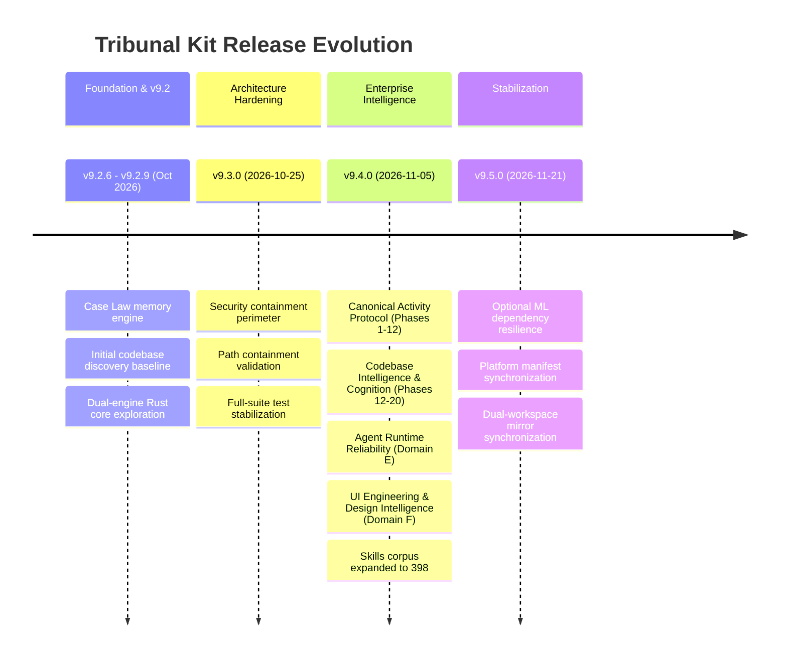

# Tribunal Kit: Changelog Context & Engineering Evolution

**Document:** `docs/CHANGELOG_CONTEXT.md`  
**Current Release:** `v9.5.0` (2026-11-21) [VERIFIED: `package.json`, `CHANGELOG.md`]  
**Audit Standard:** Fact-Based Git Commit History & Release Annotation

---

## 1. Evolution Timeline & Major Milestones

---

## 2. Release-by-Release Detailed Breakdown

### 2.1 Release 9.5.0 — 2026-11-21 [VERIFIED]

- **Git Commits:**
  - `68947f0`: `chore(bridge): update IDE bridge files from master rules`
  - `79b3393`: `chore(release): bump version to 9.5.0`
  - `2789a79`: `fix(release): support optional ML dependencies and synchronize platform manifests in version scripts`
  - `27a8839`: `chore(stabilization): complete Phase 1-5 stabilization and hardening`
- **Key Deliverables:**
  - Hardened version scripts (`scripts/sync-version.js`, `scripts/apply-version.js`) to handle optional ML dependencies gracefully without fatal build failures.
  - Synchronized platform package manifests in `npm/core-template/package.json` and `Cargo.toml`.
  - Re-certified master rules and IDE bridges across `.cursorrules`, `.windsurfrules`, and `AGENTS.md`.

### 2.2 Release 9.4.0 — 2026-11-05 [VERIFIED]

- **Git Commits:** `8f94987`, `b3e1d38`
- **Key Deliverables:**
  1. **Canonical Activity Intelligence (Phases 1–12):** Delivered typed `ActivityEvent` schema v1.0.0, cycle-safe WeakMap traversal, 13-class secret redaction, and multi-environment renderers (Markdown, Terminal, PlainText, Structured).
  2. **Codebase Intelligence Subsystem (Phases 12–20):** Integrated `tk understand` / `tribunal_understand` CLI and MCP surfaces, 7 specialized intelligence skills, and concentric blast radius calculation.
  3. **Agent Runtime Reliability (Domain E):** Integrated 10-state formal state machine, hierarchical cancellation trees with `AbortSignal`, 14-category failure normalization, and non-masking quorum consensus ($\Delta\text{Critical} = 0$).
  4. **UI Engineering & Design Intelligence (Domain F):** Constructed 21-skill target inventory, 9-step closed-loop Design Quality Loop, OKLCH color math, and banned purple clichés. Total skills reached **398 modular skills**.

### 2.3 Release 9.3.0 — 2026-10-25 [VERIFIED]

- **Git Commits:** `15caa20`, `781959c`
- **Key Deliverables:**
  - Strict path traversal containment via `assertWithinRoot` in `src/utils/path_containment.js` and `crates/core/src/commands/security.rs`.
  - SSRF defense for web navigation tools blocking RFC 1918 and cloud metadata endpoints.
  - Initial 28-reviewer wave execution partitioning.

---

## 3. Discontinued & Deprecated Approaches

1. **Eager Subcommand Loading:** Deprecated in v9.1, replaced by lazy closure-based requiring in `src/cli.js` (saving ~70% startup I/O).
2. **Single-Pass 28-Reviewer Execution:** Deprecated in v9.3 due to context window saturation, replaced by 3-wave stage-partitioned execution.
3. **Naive JSON Deep-Cloning:** Deprecated in v9.4 due to `RangeError` on circular error/AST graphs, replaced by cycle-safe WeakMap memoization.
