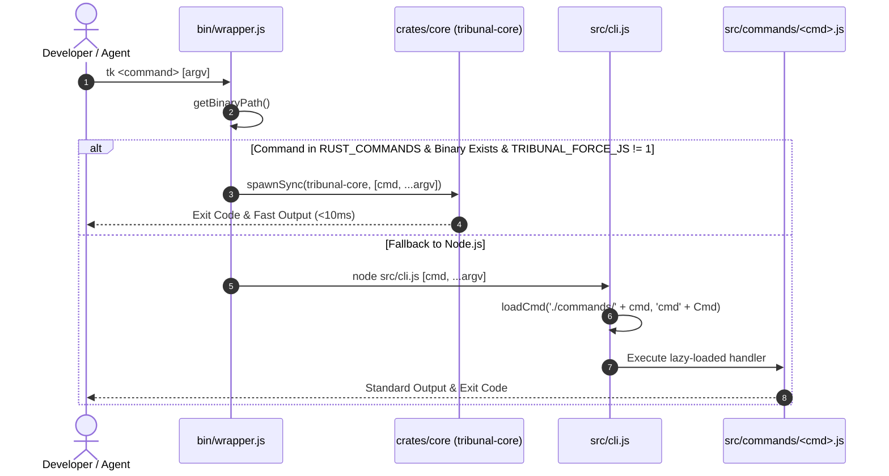
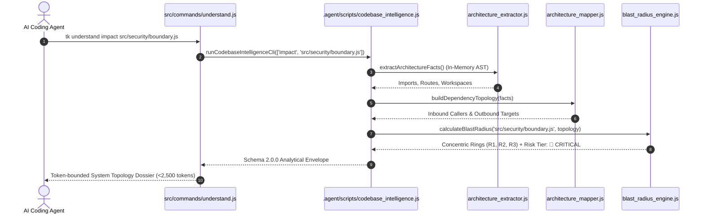
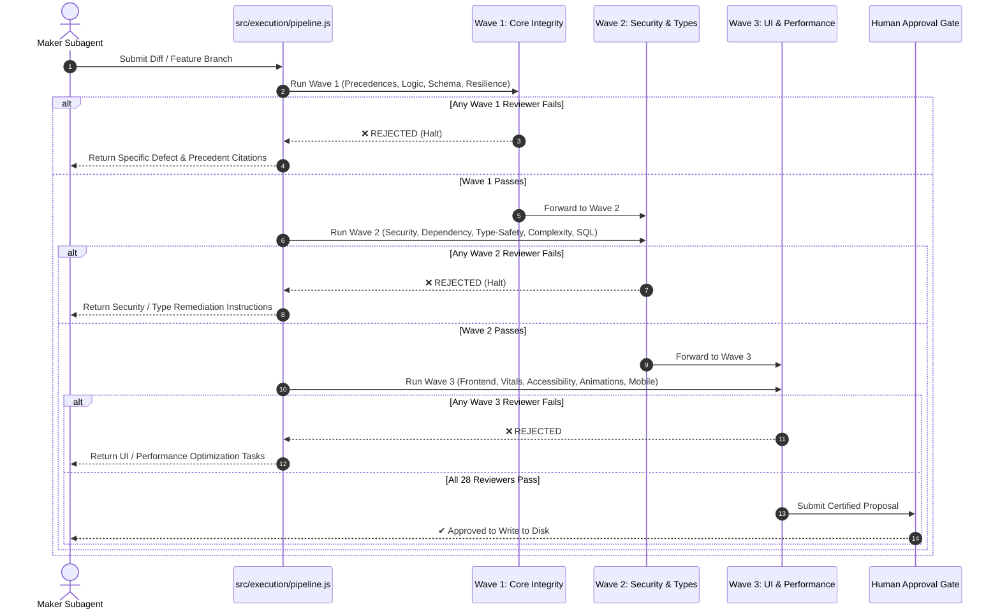
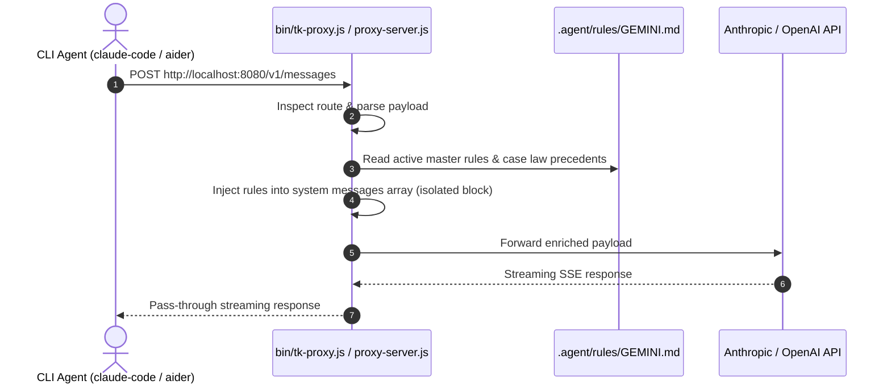

# Tribunal Kit: Detailed Execution Flows

**Document:** `docs/EXECUTION_FLOWS.md`  
**Version:** `9.5.0` [VERIFIED: `package.json`]  
**Audit Standard:** Verified Source-Code Call Graph & Data Flow Tracing

---

## Flow 1: CLI Ingress & Dual-Engine Dispatch



### Trace Details:

1. **Entry Point:** `bin/wrapper.js` [VERIFIED: `bin/wrapper.js#L1-L45`].
2. **Path Resolution:** Checks `process.env.TRIBUNAL_CORE_PATH`, then local `target/release/tribunal-core`, then optional platform packages `@tribunal-kit/core-<os>-<arch>`.
3. **Execution Decision:** If command is in `RUST_COMMANDS` (`init`, `status`, `memory`, `dag-schedule`, `context-compress`, `impact-tier`, etc.), executes the native Rust binary via `child_process.spawnSync`.
4. **Fallback:** If binary is absent or command is JavaScript-only (`understand`, `activity`, `align`, `audit-web`, `review`), loads `src/cli.js`.

---

## Flow 2: Codebase Intelligence Exploration (`tk understand`)



### Trace Details:

1. **Safety Contract:** Read-only AST extraction. The target repository hash is verified before and after execution to guarantee zero mutations (`SHA-256` oracle).
2. **Recursion Guard:** Depth-limited visited set prevents stack overflow on circular import cycles.
3. **Token Bounding:** Results are pruned to fit within LLM prompt limits without truncation.

---

## Flow 3: 28-Reviewer Wave Audit (`/tribunal-full`)



---

## Flow 4: Model Context Protocol Tool Invocation

```mermaid
sequenceDiagram
    autonumber
    actor Host as Claude / Cursor
    participant Mcp as bin/mcp-server.js
    participant Zod as Zod Schema Validator
    participant Handler as Subsystem Handler
    participant Opt as McpResponseOptimizer

    Host->>Mcp: JSON-RPC tools/call ("tribunal_understand", args)
    Mcp->>Zod: parse(args)
    alt Invalid Arguments
        Zod-->>Host: JSON-RPC Error (-32602: Invalid params)
    else Valid Arguments
        Mcp->>Handler: Execute tool logic
        Handler-->>Opt: Raw result payload
        Opt->>Opt: Strip secrets, estimate tokens, paginate if >16KB
        Opt-->>Mcp: Optimized payload (Zero double-encoding)
        Mcp-->>Host: JSON-RPC Result Envelope
    end
```

---

## Flow 5: Local Proxy Interception & Rule Injection


