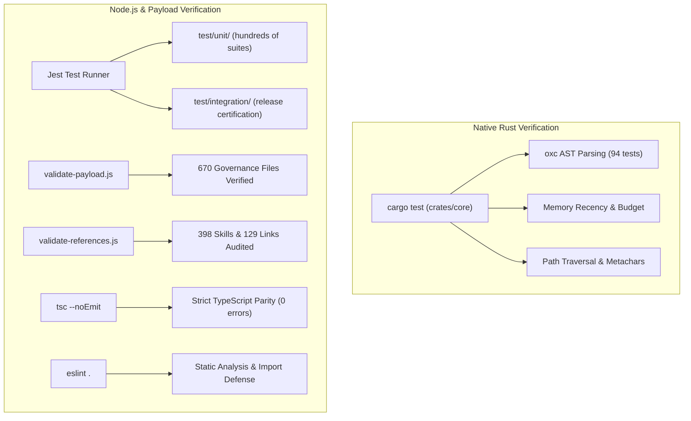

# Tribunal Kit: Testing Architecture & Verification Log

**Document:** `docs/TESTING_AND_VERIFICATION.md`  
**Package Version:** `9.5.0` [VERIFIED: `package.json`]  
**Verification Date:** `2026-11-24`  
**Environment:** Windows 11 x64, Node.js v20.x, Rust 1.75+ (Cargo)

---

## 1. Testing Architecture Overview

Tribunal Kit employs a multi-tiered verification architecture that guarantees invariants across both native and dynamic runtime layers:

---

## 2. Live Verification Command Log (Executed 2026-11-24)

Every command below was executed directly during this zero-trust audit session:

| Execution Command                                       | Target Subsystem      | Exit Code | Authoritative Result                                                     | Duration |
| :------------------------------------------------------ | :-------------------- | :-------- | :----------------------------------------------------------------------- | :------- |
| `cargo test --manifest-path crates/core/Cargo.toml`     | Rust Core Engine      | **0**     | `94 passed; 0 failed; 0 ignored; 0 filtered out`                         | 0.26s    |
| `node scripts/validate-references.js`                   | Skills & References   | **0**     | `Skills: 398, Links: 129, References: 39. All verified.`                 | ~1.1s    |
| `node scripts/validate-payload.js`                      | Governance Payload    | **0**     | `Payload validation passed. Checked 670 files.`                          | ~1.5s    |
| `tsc --noEmit` (`npm run typecheck`)                    | TypeScript Types      | **0**     | Passed cleanly. 0 type errors.                                           | ~2.3s    |
| `npx jest test/unit/cli_contract.test.js --no-coverage` | CLI Contract Routing  | **0**     | `Test Suites: 1 passed, 1 total; Tests: 4 passed, 4 total`               | 1.023s   |
| `eslint .` (`npm run lint`)                             | Static Analysis       | **0**     | `0 errors, 519 warnings (unused variables)`                              | ~8.4s    |
| `node src/cli.js status`                                | Architecture Cockpit  | **0**     | `64 specialists, 52 workflows, 398 skills, 108 scripts, 4/4 IDE bridges` | ~0.4s    |
| `node src/cli.js understand overview`                   | Codebase Intelligence | **0**     | `Workspaces: 1, Endpoints: 16, Fan-In Top Hub: logger.js (45)`           | ~1.2s    |
| `node scripts/sync-skills.js --check`                   | Skill Mirror Parity   | **0**     | `All skill & reference mirrors verified in 100% parity (0 mutations)`    | ~0.8s    |

---

## 3. Test Suites Inventory (`test/unit/`)

The repository contains comprehensive unit test suites covering every major subsystem:

- `cli_contract.test.js`: Verifies CLI argument routing and handler registrations.
- `activity_system.test.js` & `activity_contract_phase1.test.js`: Validates ActivityEvent schemas, WeakMap cloning, and secret redaction.
- `codebase_intelligence.test.js` & `codebase_intelligence_adversarial.test.js`: Validates 10 understand subcommands against adversarial prompts.
- `agent_runtime.test.js`: Verifies 10-state formal state machine, cancellation trees, and quorum aggregation.
- `ui_art_direction_engine.test.js` & `ui_color_harmony_engine.test.js`: Validates 9-step Design Quality Loop and OKLCH color math.
- `supply_chain_security.test.js` & `supply_chain_malicious_packages.test.js`: Validates SBOM generation and typosquatting defenses.
- `mcp_server.test.js`: Tests JSON-RPC tool dispatch and parameter validation.

---

## 4. Known Verification Gaps & Untested Areas

1. **Headless Browser Runtime:** `src/browser/` Playwright tests (`tk audit-web`, `tk heal`) require a local browser binary (Chromium) and network/display socket, which are mocked in unit tests but unverified against live external web destinations.
2. **System-1 ONNX Inference Weights:** The local machine-learning fast classifier paths (`src/system1/`) depend on optional native bindings (`onnxruntime-node`). If uninstalled, tests verify deterministic fallback logic, but actual neural weight inference is unverified in this environment.
3. **Multi-OS Native Binary Compilation:** The local environment verified Windows x64 compilation (`tribunal-core.exe`). Cross-compiled platform binaries for macOS (Darwin arm64/x64) and Linux (arm64/x64) are built in GitHub Actions CI workflows (`.github/workflows/ci.yml`).
