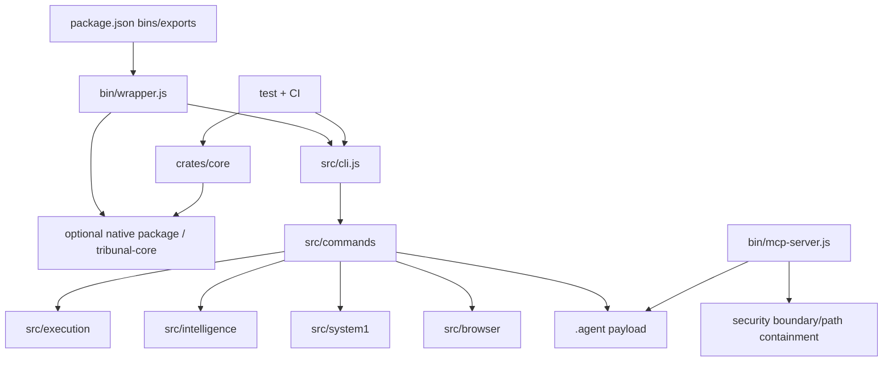

# Architecture Map

Observed communication is CommonJS `require`, filesystem configuration/payload data, spawned native executables and MCP stdio. No database or cloud service configuration was found in package manifests. Browser features use local CDP/network capability; `tk-proxy` is the explicit egress control. Error handling is command-specific; process exit and structured errors are used throughout, so end-to-end error propagation remains partially verified.
