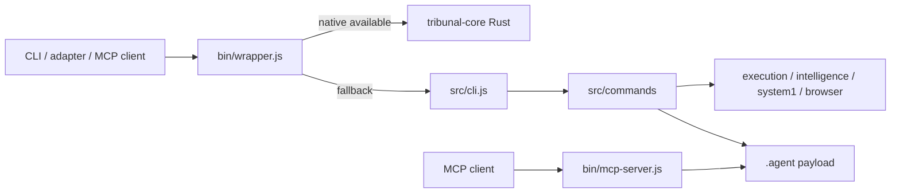

# Tribunal Kit: Project Overview

Discovery date: 2026-10-23. Evidence is current working tree source, not intent documents.

Tribunal Kit is a Node.js CLI and distributable AI-coding-agent governance payload. It installs `.agent/` rules, skills, workflows and scripts into a target repository, exposes CLI/MCP/browser-review functions, and optionally delegates supported operations to a compiled Rust binary. The public Node package declares Node >=18, CommonJS + ESM exports, four executable bins, and optional platform-native core packages.

## Runtime structure

`bin/wrapper.js` selects a platform binary and otherwise starts `src/cli.js`. The CLI parses the first positional command, lazily requires a command module, and those modules use `.agent/` scripts plus `src/{execution,intelligence,system1,browser,...}` engines. `bin/mcp-server.js` is the canonical MCP server; `src/mcp/server.js` re-exports it. Rust workspace `crates/core` supplies a `tribunal-core` binary for AST, graph, memory, scheduling and related native commands.

## Tooling and history

- Package management: npm lockfile; Rust Cargo lockfile. Main dependency is `zod`; dev tooling includes Jest, ESLint, Prettier, TypeScript, YAML, WebSocket and ONNX runtime.
- CI: `.github/workflows/ci.yml` executes lint, typecheck, version check, npm audit/CodeQL, multi-OS Node tests, Rust tests/build and packaging; release workflow builds platform binaries.
- Git: branch `main...origin/main`; 20 commits inspected through `1faaadb` (v9.2.9). The pre-existing working tree modifies only `scripts/sync-version.js`.
- Documentation claims a governance, review, memory, SDD and native-core product. Source confirms the modules exist; broad performance/security claims are not runtime-verified in this discovery.

See [ARCHITECTURE_MAP.md](ARCHITECTURE_MAP.md), [EXECUTION_FLOWS.md](EXECUTION_FLOWS.md), and registry for cross-references.
